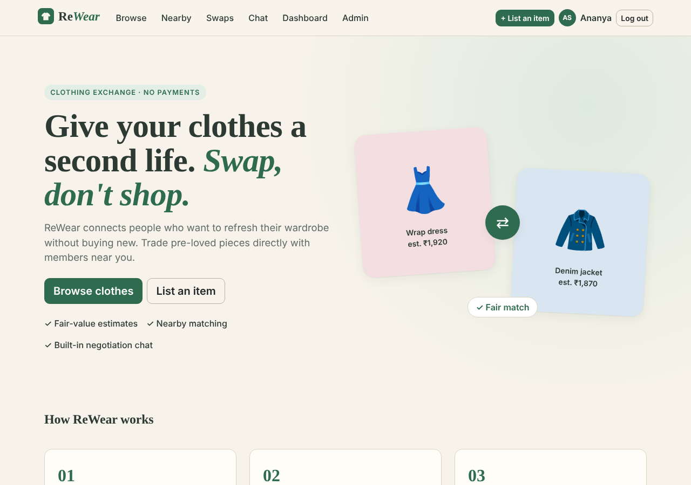
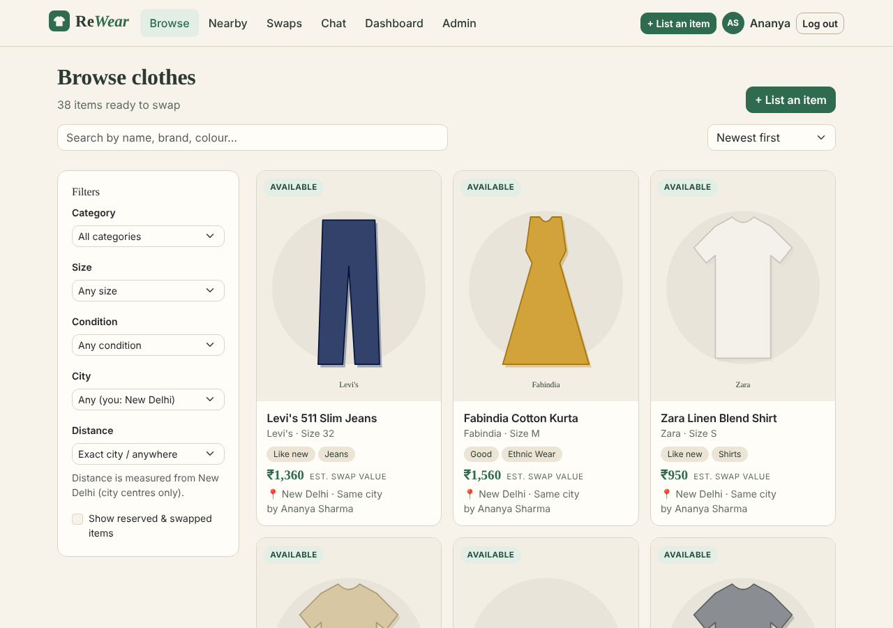
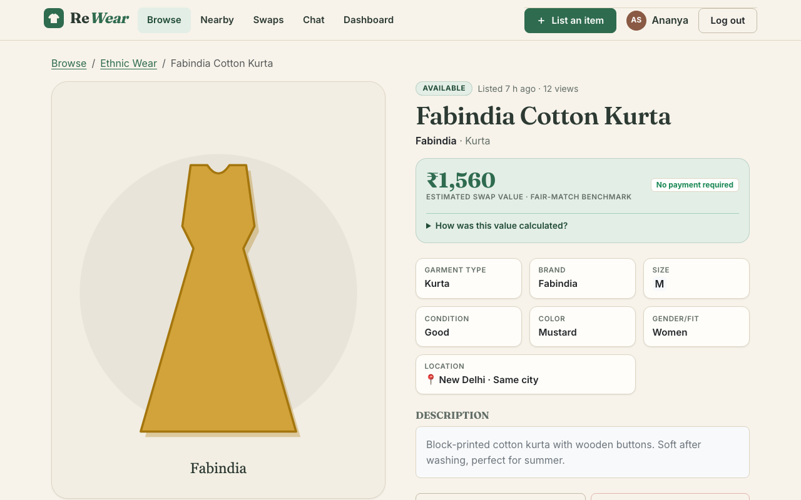
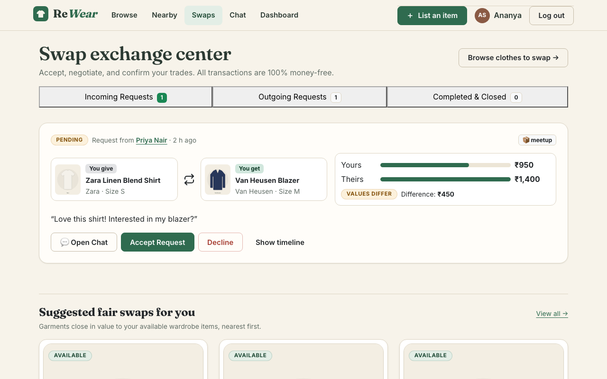
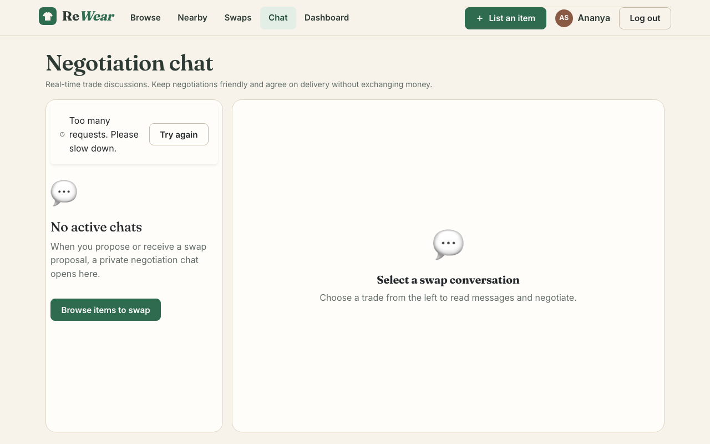
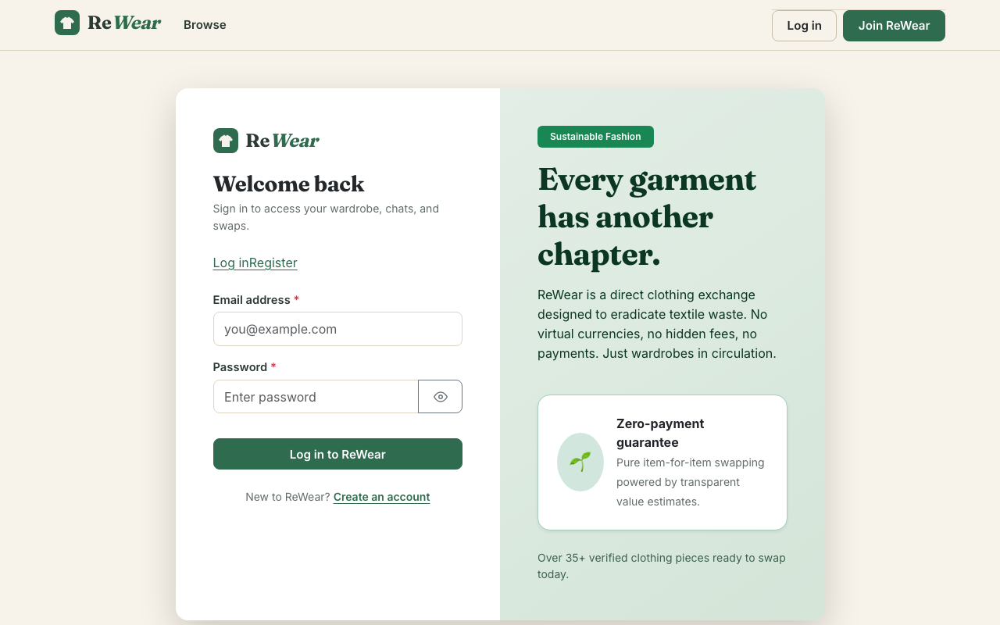

# SwapThread — Clothing Exchange & Swap Marketplace

> **Swap, don't shop.** SwapThread lets people exchange pre-loved clothes directly — no payments, less textile waste.

SwapThread is a full-stack web application (React + Node.js/Express + MongoDB) where members list clothes they no longer wear, browse items from others, propose swaps by offering one of their own items, negotiate in a built-in chat and confirm the exchange. A deterministic **swap value calculator** helps keep swaps fair, **location-based matching** surfaces nearby opportunities, and an **admin panel** handles moderation, disputes and analytics.

- **Live demo:** _add your Render URL here after deploying (see [Deployment](#13-deploy-to-render-live-link))_
- **Product requirements:** [`docs/PRD.md`](docs/PRD.md)
- **Database schema:** [`docs/DATABASE_SCHEMA.md`](docs/DATABASE_SCHEMA.md)
- **Test report:** [`docs/TEST_REPORT.md`](docs/TEST_REPORT.md)

---

## Table of contents
1. [Screenshots](#1-screenshots)
2. [Features](#2-features)
3. [Technology stack](#3-technology-stack)
4. [Folder structure](#4-folder-structure)
5. [Architecture](#5-architecture)
6. [API reference](#6-api-reference)
7. [Install on macOS (step by step)](#7-install-on-macos-step-by-step)
8. [VS Code setup](#8-vs-code-setup)
9. [Environment variables](#9-environment-variables)
10. [Database, seed data & admin account](#10-database-seed-data--admin-account)
11. [Run locally](#11-run-locally)
12. [Run the tests](#12-run-the-tests)
13. [Deploy to Render (live link)](#13-deploy-to-render-live-link)
14. [Publish to GitHub](#14-publish-to-github)
15. [Security & privacy](#15-security--privacy)
16. [Known limitations](#16-known-limitations)

---

## 1. Screenshots

Screenshots live in [`docs/screenshots/`](docs/screenshots/). The current images were rendered from the real React code with sample data; replace them with screenshots of your live site (file names in [`docs/screenshots/README.md`](docs/screenshots/README.md)).

| Home | Browse | Item & swap proposal |
|---|---|---|
|  |  |  |
| **Swaps** | **Chat** | **Admin** |
|  |  |  |

## 2. Features

The app has **8 interconnected pages** (plus a landing page), all reachable from the navigation bar:

| # | Page | Route | Highlights |
|---|---|---|---|
| 1 | Authentication | `/login`, `/register` | Validation, bcrypt hashing, httpOnly JWT cookie, customer/admin roles, protected routes |
| 2 | Clothing listings | `/listings` | Keyword search (title/brand/colour), filters (category, size, condition, city, distance), sorting, pagination, responsive cards |
| 3 | Item details | `/listings/:id` | Photo gallery, full specs, value breakdown, owner's public profile, **Propose a swap**, own-item & unavailable-item handling, report |
| 4 | Swap requests | `/swaps` | Incoming / outgoing / history, accept, reject, withdraw, cancel, confirm exchange, value comparison, timeline, fair-swap suggestions |
| 5 | Negotiation chat | `/chat/:swapId` | One conversation per swap, participants only, auto-refresh every 4 s, read-only once closed |
| 6 | User dashboard | `/dashboard` (+ `/dashboard/listings/new`, `/:id/edit`) | Stats, manage listings, photo upload, open requests, recent conversations |
| 7 | Admin panel | `/admin` | KPIs, user suspend/reactivate, listing moderation, swap monitoring, reports & disputes |
| 8 | Profile & nearby swaps | `/profile`, `/users/:id` | Edit profile & location, privacy controls, nearby items, nearby members, fair nearby suggestions |

**Swap lifecycle:** `pending → accepted → completed` (both people confirm), or `rejected` / `cancelled`.
Accepting a swap **reserves both items** and automatically closes any other open request involving them. Completing marks both items **swapped**.

**Swap value calculator** (rule-based, *not* AI):

```
estimate = round to ₹10 ( category base × brand tier × condition )
fair match  ⇔  difference ≤ ₹150  or  difference ≤ 20% of the higher value
```

Values are always labelled **"estimated swap value"** — they are a guide for comparing items, never prices. ReWear has no payments.

## 3. Technology stack

| Layer | Technology |
|---|---|
| Frontend | React 18, React Router 6, Vite 5, Bootstrap 5 + custom CSS (HTML5/CSS3/JavaScript) |
| Backend | Node.js 20+, Express 4 (REST API) |
| Database | MongoDB with Mongoose 8 (MongoDB Atlas in production) |
| Auth & security | bcryptjs, jsonwebtoken (httpOnly cookie), helmet, cors, express-rate-limit, multer |
| Images | Stored in MongoDB (≤ 2 MB each) — persistent on hosts with ephemeral disks, no extra account needed |
| Testing | Jest + Supertest + mongodb-memory-server; GitHub Actions CI |
| Hosting | Render (single web service) + MongoDB Atlas |

## 4. Folder structure

```
rewear-clothing-swap-marketplace/
├── client/                      React app (Vite)
│   ├── index.html
│   ├── public/favicon.svg
│   ├── src/
│   │   ├── App.jsx              routes for all pages
│   │   ├── main.jsx             providers + router
│   │   ├── components/          ListingCard, SwapCard, ProposeSwapModal, ValueComparison, ui.jsx …
│   │   ├── context/             AuthContext, MetaContext (catalog), ToastContext
│   │   ├── hooks/useAsync.js    data loading + debounce
│   │   ├── layouts/MainLayout.jsx  navbar + footer
│   │   ├── pages/               Home, Auth, Listings, ListingDetail, Swaps, Chat, Dashboard,
│   │   │                        ListingForm, Admin, Profile, PublicProfile, NotFound
│   │   ├── services/api.js      fetch wrapper (cookies, errors)
│   │   ├── styles/theme.css     ReWear brand theme
│   │   └── utils/format.js
│   ├── package.json
│   └── .env.example
├── server/                      Express API
│   ├── src/
│   │   ├── app.js               Express app (security middleware, routes, serves client/dist)
│   │   ├── server.js            connects to MongoDB and starts the server
│   │   ├── config/              env.js, db.js, catalog.js (categories, sizes, brands, cities)
│   │   ├── models/              User, Listing, Image, SwapRequest, Conversation, Message, Report
│   │   ├── controllers/         auth, listing, swap, conversation, user, image, report, admin
│   │   ├── routes/index.js      all REST endpoints
│   │   ├── middleware/          auth (JWT/roles), errorHandler, upload, rateLimit
│   │   ├── services/            valueCalculator, swapService (state machine), garmentArt (seed SVGs)
│   │   ├── utils/               validate, geo (haversine), serialize, ApiError
│   │   ├── data/seedData.js     realistic demo users & listings
│   │   └── scripts/             seed.js, createAdmin.js
│   ├── tests/                   Jest + Supertest suites
│   ├── package.json
│   └── .env.example
├── docs/                        PRD.md, DATABASE_SCHEMA.md, TEST_REPORT.md, screenshots/
├── .github/workflows/ci.yml     runs tests + client build on every push
├── render.yaml                  Render blueprint
├── package.json                 root scripts (build/start for deployment)
└── README.md
```

## 5. Architecture

```
 Browser (React SPA)
      │  same origin, httpOnly cookie
      ▼
 Express server  ──────────────►  MongoDB (Atlas)
  ├─ /api/*   REST API              users, listings, images,
  │   helmet · CORS · rate limit    swaprequests, conversations,
  │   JWT auth · role checks        messages, reports
  │   validation · error handler
  └─ /*       serves client/dist (built React app)
```

- **One deployable service.** In production Express serves the built React app and the API from the same domain, so the auth cookie works without cross-site configuration.
- **In development** Vite runs on port 5173 and proxies `/api` to Express on port 5000.
- **Swap consistency** uses conditional atomic updates with compensation instead of multi-document transactions, so it works on any MongoDB (including free Atlas clusters and a local standalone server). See `server/src/services/swapService.js`.
- **Chat** uses authenticated REST endpoints with 4-second polling (`?after=<timestamp>` returns only new messages).

## 6. API reference

All responses are JSON: `{ "success": true, "data": … }` or `{ "success": false, "message": "…", "errors": { field: "…" } }`.
🔒 = login required · 👑 = admin only.

| Method | Endpoint | Description |
|---|---|---|
| GET | `/api/health` | Health + database connectivity |
| POST | `/api/auth/register` | Register `{name, email, password, city}` |
| POST | `/api/auth/login` | Log in `{email, password}` (sets cookie) |
| POST | `/api/auth/logout` | Log out |
| GET 🔒 | `/api/auth/me` | Current user |
| GET | `/api/listings/meta` | Categories, sizes, conditions, cities, brand tiers |
| POST | `/api/listings/estimate` | Value estimate `{category, brand, condition}` |
| GET | `/api/listings` | Browse: `q, category, size, condition, audience, city, radiusKm, minValue, maxValue, sort (newest\|value_asc\|value_desc\|distance), includeUnavailable, page, limit` |
| GET 🔒 | `/api/listings/mine` | My listings |
| GET 🔒 | `/api/listings/nearby?radiusKm=50` | Nearby items, fair suggestions, nearby members |
| GET | `/api/listings/:id` | Item details |
| GET 🔒 | `/api/listings/:id/matches` | My items compared with this item |
| POST 🔒 | `/api/listings` | Create listing |
| PATCH 🔒 | `/api/listings/:id` | Edit own available listing |
| DELETE 🔒 | `/api/listings/:id` | Remove own listing (soft delete) |
| POST 🔒 | `/api/images` | Upload up to 4 images (`multipart/form-data`, field `images`) |
| GET | `/api/images/:id` | Serve an image |
| GET 🔒 | `/api/swaps?box=incoming\|outgoing\|all&status=` | My swap requests |
| GET 🔒 | `/api/swaps/suggestions` | Fair swaps for me, nearest first |
| GET 🔒 | `/api/swaps/compare?offered=&requested=` | Value comparison of two listings |
| POST 🔒 | `/api/swaps` | Request `{requestedListingId, offeredListingId, message?, exchangeMethod?}` |
| GET 🔒 | `/api/swaps/:id` | Swap details (participants/admin) |
| POST 🔒 | `/api/swaps/:id/accept` | Owner accepts (reserves both items) |
| POST 🔒 | `/api/swaps/:id/reject` | Owner rejects `{note?}` |
| POST 🔒 | `/api/swaps/:id/cancel` | Withdraw (pending, requester) / cancel (accepted, either) |
| POST 🔒 | `/api/swaps/:id/confirm` | Confirm the exchange happened (both → completed) |
| GET 🔒 | `/api/conversations` | My conversations |
| GET 🔒 | `/api/swaps/:id/messages?after=` | Conversation messages |
| POST 🔒 | `/api/swaps/:id/messages` | Send `{body}` (participants only) |
| GET 🔒 | `/api/users/me/dashboard` | Dashboard statistics |
| PATCH 🔒 | `/api/users/me` | Update profile & location |
| PATCH 🔒 | `/api/users/me/password` | Change password |
| GET | `/api/users/:id` | Public profile (no email/phone) |
| POST 🔒 | `/api/reports` | Report a listing/user or open a swap dispute |
| GET 👑 | `/api/admin/stats` | KPIs & analytics |
| GET 👑 | `/api/admin/users?q=&status=` | Users |
| PATCH 👑 | `/api/admin/users/:id/status` | Suspend / reactivate `{status, reason?}` |
| GET 👑 | `/api/admin/listings?q=&status=` | All listings |
| PATCH 👑 | `/api/admin/listings/:id` | Edit / restore listing |
| DELETE 👑 | `/api/admin/listings/:id` | Remove listing `{reason?}` |
| GET 👑 | `/api/admin/swaps?status=` | All swaps |
| GET 👑 | `/api/admin/reports?status=` | Reports & disputes |
| PATCH 👑 | `/api/admin/reports/:id` | Resolve / dismiss `{status, adminNote?}` |

## 7. Install on macOS (step by step)

Open the **Terminal** app and run these one at a time.

1. **Install Homebrew** (skip if `brew --version` already works):
   ```bash
   /bin/bash -c "$(curl -fsSL https://raw.githubusercontent.com/Homebrew/install/HEAD/install.sh)"
   ```
2. **Install Node.js 20 and Git:**
   ```bash
   brew install node@20 git
   brew link --overwrite node@20
   node -v   # should print v20.x or newer
   ```
3. **Get the project.** Either unzip the downloaded `rewear-clothing-swap-marketplace.zip` into your home folder, or clone your GitHub repo. Then:
   ```bash
   cd ~/rewear-clothing-swap-marketplace
   ```
4. **Install dependencies** (server and client):
   ```bash
   npm run install:all
   ```
5. **Choose a database** — either:
   - **Option A (recommended, no installs): MongoDB Atlas** — follow [section 13, step 1](#step-1--create-a-free-mongodb-atlas-database) to get a connection string, or
   - **Option B: local MongoDB:**
     ```bash
     brew tap mongodb/brew
     brew install mongodb-community@7.0
     brew services start mongodb-community@7.0
     ```
6. **Create your `.env` file:**
   ```bash
   cp server/.env.example server/.env
   node -e "console.log(require('crypto').randomBytes(48).toString('hex'))"
   ```
   Open `server/.env` and paste the printed value as `JWT_SECRET=`. If you use Atlas, set `MONGODB_URI=` to your Atlas connection string.

## 8. VS Code setup

1. Install [Visual Studio Code](https://code.visualstudio.com/), then open the project: **File → Open Folder… → rewear-clothing-swap-marketplace**.
2. Accept the prompt to install the **recommended extensions** (ESLint, Prettier, MongoDB, REST Client) from `.vscode/extensions.json`.
3. Open two terminals with **Terminal → New Terminal** (use the ➕ button for the second one) for the server and client commands in [section 11](#11-run-locally).

## 9. Environment variables

`server/.env` (copy from `server/.env.example`; **never commit this file** — it is in `.gitignore`):

| Variable | Example | Purpose |
|---|---|---|
| `PORT` | `5000` | API port (Render sets this automatically) |
| `NODE_ENV` | `development` / `production` | Enables secure cookies & generic errors in production |
| `MONGODB_URI` | `mongodb://127.0.0.1:27017/rewear` | Database connection string |
| `JWT_SECRET` | long random string | Signs login tokens (**required** in production) |
| `JWT_EXPIRES_IN` | `7d` | Session length |
| `CLIENT_ORIGIN` | `http://localhost:5173` | Allowed browser origin(s), comma-separated |
| `ADMIN_NAME`, `ADMIN_EMAIL`, `ADMIN_PASSWORD` | — | Only for `npm run create-admin` (leave empty in the file; pass on the command line) |

`client/.env.example` contains `VITE_API_BASE_URL` — leave it empty (same-origin is the supported setup).

## 10. Database, seed data & admin account

**Seed realistic demo data** (10 members in 10 Indian cities, 39 listings with illustrations, swaps in every state, chats and a report):
```bash
npm run seed                 # first time
npm run seed -- --reset      # wipe everything except admins and re-seed
```
The script prints the **demo password**. Log in as e.g. `ananya@demo.rewear.app` (all demo emails are in `server/src/data/seedData.js`). To choose the password yourself: `SEED_USER_PASSWORD='MyDemo123' npm run seed`.

**Create the first administrator** (no admin password is hard-coded anywhere):
```bash
npm run create-admin
```
It asks for name, email and password (min 10 characters with letters and numbers). Non-interactive version:
```bash
ADMIN_NAME="Site Admin" ADMIN_EMAIL="admin@example.com" ADMIN_PASSWORD='Choose-A-Str0ng-Pass' npm run create-admin
```
If the email already belongs to a member, that account is promoted to admin. Log in and open **Admin** in the navigation.

## 11. Run locally

Terminal 1 — API:
```bash
npm run dev:server        # http://localhost:5000  (check http://localhost:5000/api/health)
```
Terminal 2 — React app:
```bash
npm run dev:client        # open http://localhost:5173
```
Production-like run (one server serving everything):
```bash
npm run build
NODE_ENV=production JWT_SECRET=<your-secret> npm start     # open http://localhost:5000
```

## 12. Run the tests

```bash
npm test                              # all API tests (starts an in-memory MongoDB automatically)
npm run test:unit --prefix server     # only the pure unit tests (no database)
```
The first `npm test` downloads a MongoDB binary for `mongodb-memory-server` (~100 MB, once). To use your own MongoDB instead: `MONGODB_URI_TEST=mongodb://127.0.0.1:27017 npm test`.
GitHub Actions runs the full suite and the client build on every push (`.github/workflows/ci.yml`) — check the **Actions** tab of your repository. Results are recorded in [`docs/TEST_REPORT.md`](docs/TEST_REPORT.md).

## 13. Deploy to Render (live link)

ReWear deploys as **one Render web service** (Express serves the React build) plus a free **MongoDB Atlas** database.

### Step 1 — Create a free MongoDB Atlas database
1. Sign up at <https://www.mongodb.com/cloud/atlas/register> and create a **free M0 cluster**.
2. **Database Access → Add New Database User:** choose a username and an auto-generated password (save it somewhere private).
3. **Network Access → Add IP Address → Allow access from anywhere** (`0.0.0.0/0`) — required because Render's IP addresses change.
4. **Database → Connect → Drivers:** copy the connection string and insert your password and the database name `rewear`:
   `mongodb+srv://<user>:<password>@<cluster>.mongodb.net/rewear?retryWrites=true&w=majority`

### Step 2 — Put the code on GitHub
Follow [section 14](#14-publish-to-github).

### Step 3 — Create the Render service
1. Sign up at <https://render.com> with your GitHub account.
2. **New → Blueprint** → select your `rewear-clothing-swap-marketplace` repo → Render reads `render.yaml`.
   *(Alternatively **New → Web Service** with Build Command `npm run build`, Start Command `npm start`, Health Check Path `/api/health`.)*
3. When asked for environment variables, set:
   - `MONGODB_URI` = your Atlas connection string
   - `CLIENT_ORIGIN` = your Render URL, e.g. `https://rewear-clothing-swap-marketplace.onrender.com` (you can add it after the first deploy, then click **Manual Deploy**)
   - `JWT_SECRET` is generated automatically by the blueprint (for a manual web service, add a long random value yourself).
4. Click **Apply / Create**. The first build takes a few minutes. Open `https://<your-service>.onrender.com/api/health` — it should say `"database":"connected"`.

### Step 4 — Seed the live database and create the admin (from your Mac)
Render's free plan has no shell, so run the scripts locally against Atlas:
```bash
cd ~/rewear-clothing-swap-marketplace
MONGODB_URI='mongodb+srv://<user>:<password>@<cluster>.mongodb.net/rewear?retryWrites=true&w=majority' npm run seed
MONGODB_URI='mongodb+srv://<user>:<password>@<cluster>.mongodb.net/rewear?retryWrites=true&w=majority' npm run create-admin
```

### Step 5 — Verify the live site
Open the Render URL and check: register → log in → list an item with a photo → from a second account propose a swap → accept → chat → both confirm → log in as admin and view the KPIs. Then paste the URL at the top of this README.

> Free Render services sleep after ~15 minutes of inactivity; the first request afterwards can take up to a minute.

## 14. Publish to GitHub

1. Create an empty repository at <https://github.com/new> named **`rewear-clothing-swap-marketplace`** (Public, **no** README/.gitignore — the project already has them).
2. In Terminal:
   ```bash
   cd ~/rewear-clothing-swap-marketplace
   git status                      # make sure no .env file is listed
   git add .
   git commit -m "ReWear clothing swap marketplace"
   git branch -M main
   git remote add origin https://github.com/<your-username>/rewear-clothing-swap-marketplace.git
   git push -u origin main
   ```
   (If the project folder already contains a `.git` folder with a commit, skip `git add`/`git commit` and only run the last three commands.)
   GitHub will ask you to sign in — use the browser sign-in or a [personal access token](https://github.com/settings/tokens) as the password.
3. Your submission link is `https://github.com/<your-username>/rewear-clothing-swap-marketplace`.

## 15. Security & privacy

- Passwords hashed with **bcrypt (cost 12)**; login errors never reveal whether an email exists.
- **JWT in an httpOnly, SameSite=Lax cookie** (Secure in production); token never exposed to JavaScript.
- **Role checks on the server** for every admin route; roles, owners, user IDs and swap values are never read from the client.
- **Validation on client and server**; unknown fields are dropped (no mass assignment); search input is regex-escaped.
- **Rate limiting** on login/register (20 per 15 min per IP) and on the whole API.
- **Helmet** security headers incl. Content-Security-Policy; strict **CORS** allow-list.
- **Uploads:** JPEG/PNG/WebP only, ≤ 2 MB, max 4, verified by file signature; served with `nosniff` and a sandbox CSP.
- **Generic error messages in production**; secrets only in environment variables (`.env` is git-ignored).
- **Privacy:** only city (and neighbourhood if the user opts in) is public; email and phone are never shown to other members; distances are rounded and measured between city centres.

## 16. Known limitations

- **Chat is near-real-time (polling every 4 s), not WebSockets.** Chosen for reliability on free hosting; Socket.IO is a listed future enhancement.
- **Location is city-level** (16 supported Indian cities in `server/src/config/catalog.js`). This protects privacy but makes distances approximate. Add cities by editing that file.
- **Images are stored in MongoDB** (2 MB limit each). This keeps them persistent on Render's free tier without another account; a CDN such as Cloudinary would be better at large scale.
- **Courier integration** is manual — users agree courier details in chat; no booking API.
- **Estimated swap values** are rule-based suggestions, not market prices or AI predictions.
- Render free instances sleep when idle (slow first load).
