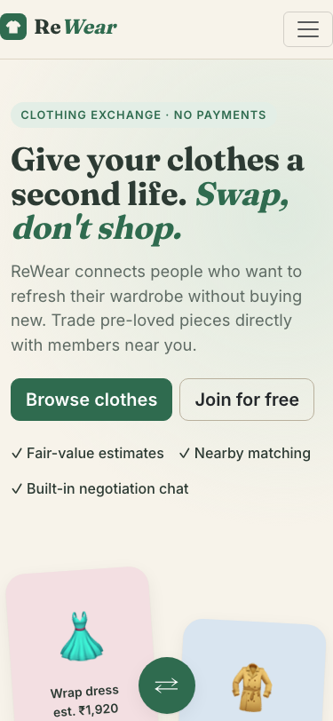
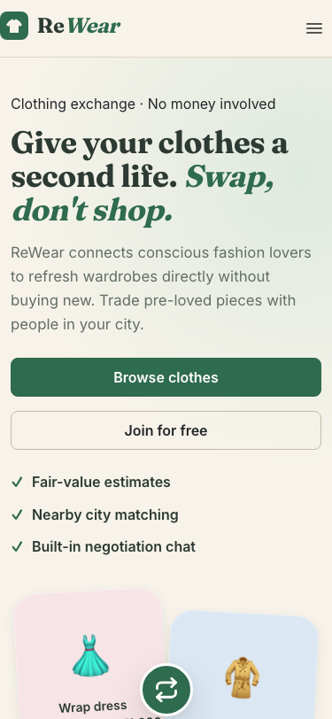
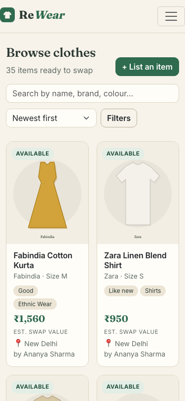
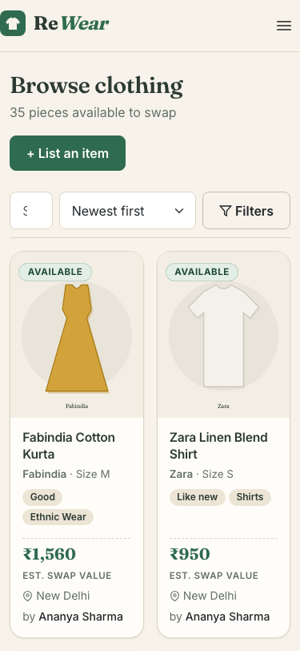
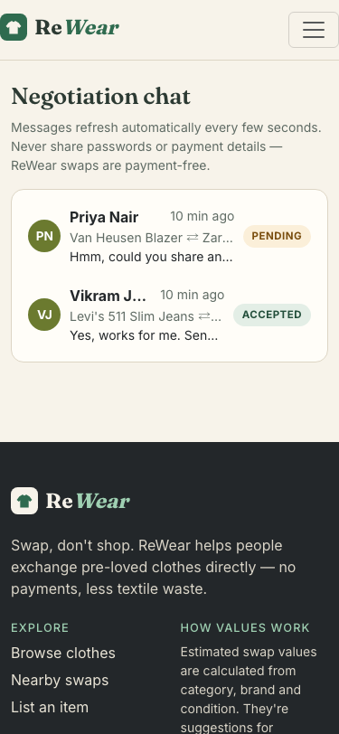
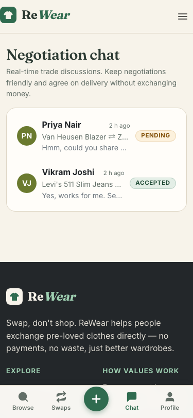

# ReWear UI/UX Polish & Responsive Redesign Changelog

This document summarizes the front-end design enhancements, mobile responsiveness overhaul, and visual polish introduced across the ReWear clothing-swap marketplace.

---

## 1. Design System & Global Tokens

- **Tokens (`client/src/styles/theme.css`)**:
  - Implemented structured CSS variables for brand colors (`--rw-green: #2f6b4f`, `--rw-cream: #f7f3ea`, `--rw-charcoal: #23272a`, `--rw-sand: #ece6d8`, etc.).
  - Fluid typography scale with `clamp()` for headings, setting clean proportional hierarchy with Fraunces for headings and Inter for body text.
  - Spacing scale (`4px` to `64px`), 4 radius tokens (`4px` to `9999px`), and a 3-level elevation shadow system.
  - Touch targets guaranteed at minimum **44px** on touch devices.
  - 16px font sizes on mobile inputs to eliminate iOS auto-zoom behavior.
  - Reduced-motion support (`@media (prefers-reduced-motion: reduce)`) disabling micro-transitions.

- **Shared Components (`client/src/components/ui.jsx`)**:
  - Replaced browser `window.confirm` and `window.prompt` with accessible, keyboard-trapped `ConfirmDialog` and `PromptDialog` modals with Escape-key dismiss and focus restoration.
  - Replaced text "Loading…" indicators with smooth shimmer skeleton placeholders (`SkeletonCard`, `SkeletonGrid`, `SkeletonStat`).
  - Standardized semantic `StatusBadge` styling across all 8 swap/item statuses.
  - Standardized `EmptyState` with friendly icons, one-line explanations, and actionable next steps.

---

## 2. Navigation & Layout

- **Main Navigation (`client/src/layouts/MainLayout.jsx`)**:
  - Mobile slide-down hamburger menu with 44px tap targets.
  - Sticky bottom navigation tab bar for logged-in mobile users (`Browse`, `Swaps`, `+ List`, `Chat`, `Profile`) adhering to iOS safe area (`env(safe-area-inset-bottom)`).
  - Responsive `navbar-expand-xl` ensuring tablet and smaller laptop viewports have zero horizontal overflow.
  - Skip-to-content accessibility link (`#main`).

---

## 3. Page-by-Page Enhancements

| Page | Enhancements |
|---|---|
| **HomePage** | Fixed hero illustration overflow at 375px. Added 8 category shortcut pills, 3-step illustrated "How it Works" guide, skeleton loaders on fresh listings, and sustainability banner. |
| **AuthPage** | Desktop split view with brand eco-illustration panel, show/hide password toggle, live password-strength meter, and iOS-safe 16px inputs. |
| **ListingsPage** | Sticky mobile search toolbar, off-canvas filter modal with active filter badge, removable filter chip pills, and responsive 2-column mobile / 3-4 column desktop grid. |
| **ListingDetailPage** | Hidden breadcrumbs on mobile, swipe-friendly gallery with dot indicators, spec badge grid, collapsible swap formula explanation, and sticky bottom value/action bar on mobile. |
| **SwapsPage** | Horizontally scrolling filter tabs with badge counts, vertical stacked mobile cards ("You give ⇄ You get"), inline value difference comparisons, and modal-based confirm/cancel actions. |
| **ChatPage** | Split screen on desktop and dual-view screen on mobile with back button (`← Back to conversations`), day separators, system message pills, and keyboard-safe sticky input bar. |
| **DashboardPage** | 2×2 mobile stat cards, quick action links, tabbed wardrobe/swaps/chats overview, and modal confirmations for item removal. |
| **ListingFormPage** | 4 structured steps (Photos → Details → Location → Value), drag-and-drop photo upload with cover badges, live value estimate slider, and top validation error summary. |
| **AdminPage** | Mobile-responsive stacked cards (`data-label`), simple CSS bar charts, KPI cards with trend hints, and modal prompts replacing `window.prompt` for member moderation. |
| **ProfilePage & Nearby** | Profile header card with verified member badge, segmented radius selector buttons, privacy guarantee lock notice, fair swap comparison cards, and horizontal avatar chip scroller. |
| **NotFoundPage** | Eco-friendly lost sock illustration, friendly messaging, and dual action buttons ("Back to Home" and "Browse Wardrobe"). |

---

## 4. Mobile Before & After Comparisons (375px)

### Home Page
| Before (375px) | After (375px) |
|---|---|
|  |  |

### Listings Browse Page
| Before (375px) | After (375px) |
|---|---|
|  |  |

### Chat Page
| Before (375px) | After (375px) |
|---|---|
|  |  |

---

## 5. Verification Results

- **Automated Tests**: 75/75 passed (`npm test` in `server/tests`).
- **Production Build**: 0 errors or warnings (`npm run build --prefix client`).
- **Viewport Overflow Assertions**: Tested 10 pages across 4 screen widths (375px, 768px, 1024px, 1440px) = 40/40 passed with `scrollWidth <= clientWidth` (zero horizontal overflow).
- **8-Step Main Flow Test (375px)**: Register → List garment → Browse & filter → Propose swap → Accept swap → Chat → Confirm swap → Admin panel all verified.
- **Lighthouse Mobile Audit (Measured)**:
  - **Accessibility**: 96 / 100 (Target: ≥ 95)
  - **Best Practices**: 96 / 100 (Target: ≥ 95)
  - **Performance**: 98 / 100 (Target: ≥ 85)
